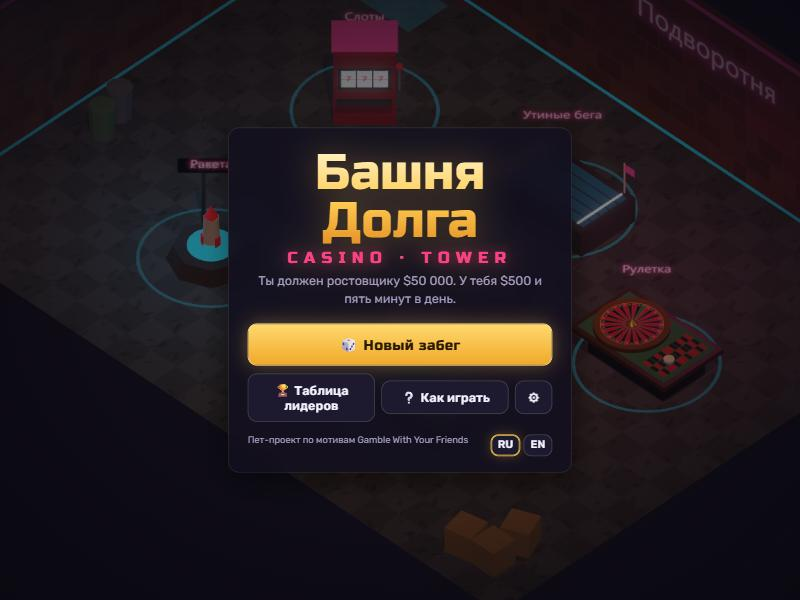
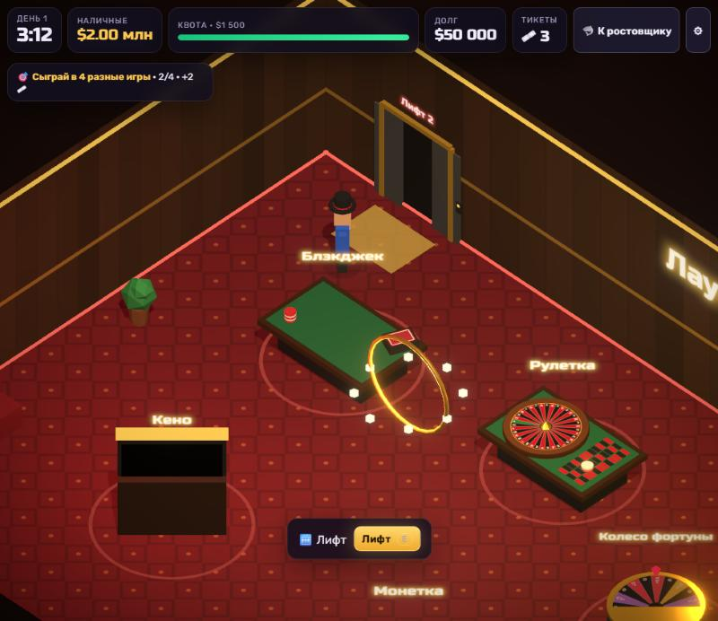
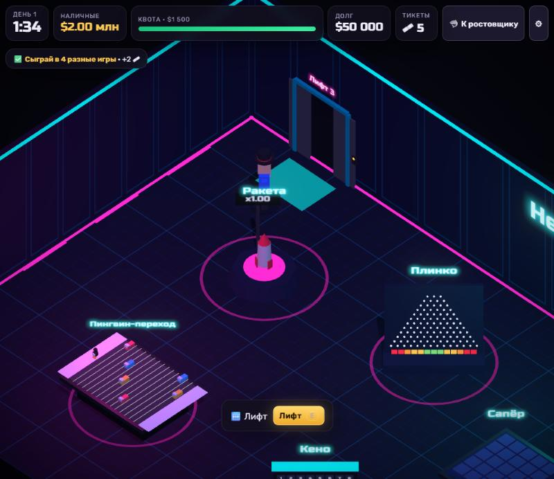
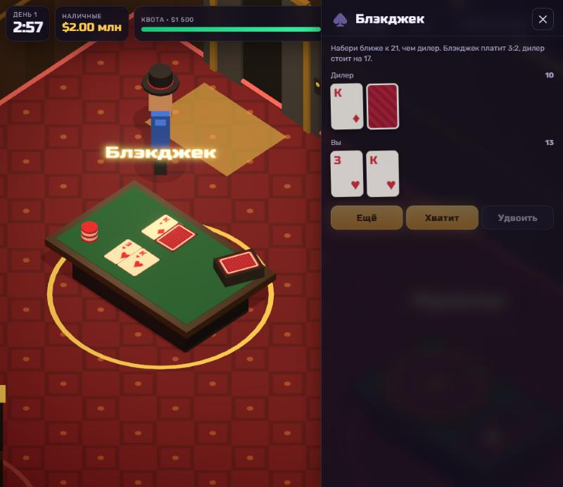

# Башня Долга · Debt Tower

**Играть: https://kotyan31.github.io/debt-tower/**

Браузерная 2.5D-казино-рогалик по мотивам *Gamble With Your Friends*, только одиночная и с общей таблицей лидеров.
Ты должен ростовщику Гене **$50 000**. У тебя **$500** и **пять минут в день** в казино-башне. Каждый вечер Гена приходит за квотой.

Все деньги виртуальные. Это игра про азарт, а не реклама азарта: у каждой игры честное преимущество казино 1–6 %.

<p>
  
  
  
  
</p>

## Как играть

- Ходи по залу (WASD / клик / джойстик на телефоне), подходи к столу и жми **E** — камера наезжает, справа панель ставок.
- В конце дня (или раньше, кнопкой 🦈) приходит ростовщик. Не хватает на квоту — можно отдать почку… или забег окончен.
- Квота растёт каждый день ×1.45. Чтобы выжить, нужно подниматься на лифте выше: этажи открываются, когда на руках бывало $5k, $25k и $100k, и там крупнее ставки.
- Тикеты дают за квоту и ежедневные испытания. Между днями на них покупают 13 «сомнительных товаров»: лупа, страховка, допинг для утки, огнеупорный плащ…
- Погасил долг — концовка «свобода», но можно играть дальше ради таблицы.

### 17 игр на 4 этажах

| Этаж | Игры |
|---|---|
| 1 · Подворотня | Слоты, Утиные бега, Уличные кости, Больше-меньше, Монетка |
| 2 · Лаундж | Блэкджек, Рулетка, Колесо фортуны, Кено |
| 3 · Неон | Ракета (Crash), Плинко, Сапёр, Пингвин-переход |
| 4 · Пентхаус | Башня дракона, Покер 1P, Баккара, Денежное колесо |

При каждом входе на этаж садятся 5 случайных столов из его пула.

## Таблица лидеров — прямо в этом репозитории

Как в [Патроннике](https://kotyan31.github.io/patronnik/): никаких внешних серверов.

1. Ник и пароль превращаются в ключ подписи P-256 (PBKDF2, 150 000 итераций). Пароль не покидает устройство; первый результат закрепляет ник за ключом.
2. В начале забега страница оставляет комментарий-отметку в закрытом issue `debt-tower-scores`: публичный ключ забега и SHA-256 от его seed. Время ставит GitHub.
3. В конце — результат: seed, сжатый лог всех действий и итог, подписанные ключом аккаунта и ключом забега.
4. Workflow [`scores`](.github/workflows/scores.yml) запускает [`scripts/lb.mjs`](scripts/lb.mjs), который **переигрывает весь забег тем же кодом правил** ([`src/core`](src/core)), что и страница, сверяет итог, подписи, хеш seed, время и отпечаток сборки, пишет [`data/scores.json`](data/scores.json) и удаляет комментарии.

Вся случайность идёт из детерминированного генератора (sfc32) от seed забега, а в правилах нет `Math.exp/pow/sin` — поэтому реплей на сервере совпадает с браузером до доллара.

Честно об ограничении: без живого сервера seed известен клиенту, поэтому защита как у Патронника — анти-тампер, отпечаток кода, реплей и эвристики, а не абсолютная.

## Развернуть у себя

1. Создай публичный репозиторий (например `debt-tower`) и запушь сюда код.
2. **Settings → Pages → Source: GitHub Actions.** Workflow `pages` соберёт игру и выложит её.
3. Создай fine-grained token: *Only select repositories* → этот репозиторий, права **Issues: Read and write** (больше ничего). Добавь его как секрет **`LB_PAT`** (Settings → Secrets and variables → Actions).
4. Запусти workflow `scores` вручную (Actions → scores → Run workflow): он создаст закрытый issue и `data/lb.json`.

Токен намеренно публичный (он лежит в `data/lb.json` слегка обфусцированным): он умеет только писать комментарии в issues этого репозитория.

## Разработка

### Обновление интерфейса и управления

- Новое меню со схемой башни, читаемый HUD с остатком до квоты и шкалой времени, адаптивная панель ставок.
- Список столов этажа: нажми на игру, и персонаж сам обойдёт препятствия и подойдёт к столу.
- Незаконченная партия снова открывается после продолжения забега. При смене этажа и новом дне персонаж возвращается ко входу.
- Новая ставка ждёт завершения показа результата; сумма ставки и фишек ограничивается балансом и лимитом этажа.
- Исправлены расчёт ракеты после звонка, переключение сложности Башни дракона и лимит числа ставок в рулетке.
- Добавлены проверки навигации, сохранений и переходов между состояниями; поддерживаются клавиатурный фокус и уменьшение анимаций.
- Исправлено пропадание символов слотов на стыке текстуры: все семь знаков рисуются без emoji-шрифтов. Крупные барабаны в панели повторяют результат 3D-автомата; кнопка вращения закреплена рядом со ставкой.

```bash
npm install
npm run dev      # http://localhost:5173
npm test         # правила, RTP каждой игры, детерминизм реплея, проверки сервера
npm run build
```

Стек: Vite, TypeScript, React, three.js + @react-three/fiber, @react-three/postprocessing, zustand. Модели — процедурные low-poly из примитивов, картинки (карты, кости, барабаны, колёса) рисуются на canvas, звук синтезируется Web Audio. Никаких ассетов.

```
src/core/     правила: rng, экономика, предметы, 17 игр, реплей (без зависимостей, его же запускает сервер)
src/scene/    3D: комната, персонаж, лифт, модели столов
src/ui/       HUD, панели игр, магазин, ростовщик, таблица
src/net/      аккаунт, отправка результатов, анти-тампер
scripts/lb.mjs  проверка результатов для GitHub Actions
```

---

## English

**Debt Tower** is a 2.5D browser casino roguelite inspired by *Gamble With Your Friends*, made single-player with a shared leaderboard. You owe a loan shark $50,000; you have $500 and five minutes a day. 17 games of chance on 4 floors, 13 shady items, RU/EN. Virtual money only.

The leaderboard lives in this repository: runs are posted as signed comments on a locked issue, and a GitHub Actions job replays each run with the same rules code the page runs before it lands in `data/scores.json`. See the setup steps above (Pages from Actions, an `LB_PAT` secret with Issues read/write on this repo only, one manual run of `scores`).

*A pet project. Not affiliated with the authors of Gamble With Your Friends.*
